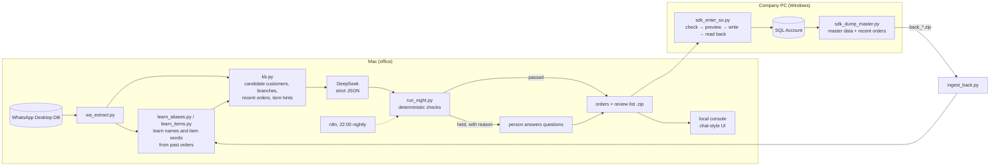

# WhatsApp Order Intake → SQL Account

Turns free-text orders from a poultry distributor's WhatsApp sales groups into Sales Orders in
**SQL Account**, a Malaysian accounting/ERP system. An LLM reads the messages. Deterministic checks
decide which drafts can be trusted. A person approves the final batch before anything is written.

> **All customer, product and order data in this repository is synthetic**, modeled on real message patterns.
> The production data never leaves the company.

> This project was built with extensive AI assistance. See [Development process & AI assistance](#development-process--ai-assistance).

---

## The problem

Every evening, three WhatsApp groups receive about 60–90 orders for the next day. Salespeople and
customers type them however they like:

```
16/10                      Kedai Makan Aminah         Happy Wok 快乐镬
Golden Spoon               esok                       16/10
Melawati                   Kepak 5kg                  Drumstick 10kg @ 9.80
Wing 10kg                  Peha ayam 40 ekor          Wing 5kg (RM11.50)
Boneless leg 2 ctn
```

A clerk used to retype every one of them into SQL Account at night. For each order they had to:

- find the right **customer and branch** among ~500 active customers and ~1,100 branches, even though the chat
  uses nicknames, outlet names or only the delivery address;
- map each line to an **item code**, sometimes per customer (one customer's "boneless leg" always means the *cubed* item);
- convert **units**: `ctn` = 12 kg and `pkt` = 2 kg. Head-count lines (`40 ekor`, `100pcs`) are entered as quantity 0 with
  `- 40PCS` in the description, because the weight is only known after packing;
- keep **same-day orders** posted after midnight out of the batch, since the morning shift handles them;
- handle replies such as `Add wing 3kg`, staff-meal lines that need a separate invoice, PO numbers, and prices written in the text.

## Results (real deployment, aggregate numbers only)

| | |
|---|---|
| First live night (9 Oct 2026) | **83 orders** entered through the SQL Account SDK. Every one was read back from the system and matched. |
| First 6 nights (9–15 Oct) | **423 Sales Orders** entered by the SDK script. A person checked each batch and signed it off before it was written. |
| DeepSeek shadow mode, replayed on 5 nights (346 human-verified orders) | **96.2%** of the drafts it released were correct in every field (customer, branch, date, Ref1, items). **76.6%** of orders were released automatically; the rest were held for a person, each with a reason. |
| Held-out nights (not used while tuning the prompt) | 97.7% and 96.7% of released drafts fully correct. |

## How it works



The loop closes every night. The company PC sends back the orders as they were actually entered,
plus fresh master data, and the next night learns from them.

## Key design decisions

1. **Learn from what was actually entered, not from guesses.** `learn_aliases.py` pairs each past chat message
   with the Sales Order that was really entered, using only the delivery date and the quantity signature
   (with ctn/pkt converted), never the name. The name → customer table built from those pairs is therefore
   evidence. Only the most recent entries count, because customers move between accounts.
2. **The LLM chooses, the code decides.** The model only picks from a ranked list of candidate customers and
   from the item master. `check_order()` then holds anything that cannot be verified: inactive or
   non-candidate customer, unknown branch, delivery date not in the future, item or UOM never used before,
   a head-count order entered as kg, or a description shape never seen before. A draft where the model asked
   a question is held too. **Hold rather than guess.**
3. **Shadow mode before trust.** DeepSeek runs alongside the human-reviewed process and its output is only
   compared, never entered. Trust has to be earned with numbers first.
4. **Replay evaluation without leakage.** The knowledge base is cut at a point in time, so replaying a past
   night only sees the data that existed then. `eval.py` compares field by field with the orders that were
   entered and verified.
5. **Safe writes to the ERP.** The SDK script has three modes: check codes, preview in memory, write. After
   saving it reads the order back and verifies it. A log makes reruns idempotent. The amend script only
   touches an order that still matches its recorded "before" state.
6. **Cost-aware model choice.** Development used Claude. The nightly run uses DeepSeek (flash, low reasoning
   effort) with a prompt cache, so replays cost nothing.

## Try the demo

Python 3.10+, standard library only:

```bash
python3 demo/run_demo.py
```

This generates a synthetic workspace (332 history messages, 264 past Sales Orders, one night of 15 new
messages). It then runs the **production code unchanged** on that workspace: the learners, candidate
ranking, prompt building, checks and replay evaluation. DeepSeek answers are replayed from
`demo/recorded/`, which holds real DeepSeek responses to these synthetic prompts. Run with
`--record` and a `DEEPSEEK_API_KEY` to call the model live.

The recorded run: 9 orders released and fully correct, 2 held for a person (a new customer, and an add-on
whose description failed the shape check), and 1 wrong release that the checks missed (an ambiguous "duck"
the model should have asked about). [demo/README.md](demo/README.md) lists what each message tests and
analyses the miss.

## Tests

```bash
pip install -r requirements-dev.txt
pytest
```

The tests cover unit conversion, order-header parsing in each salesperson's layout, item-line parsing,
per-customer item overrides, the deterministic checks and order merging.

## Repository layout

| Path | What it does |
|---|---|
| `tools/` | Read WhatsApp Desktop DB; learn customer and item aliases; pack the nightly zip |
| `pipeline/` | Knowledge base, DeepSeek client, nightly run + checks, replay evaluation, attachment (PDF/image) reading, return-package ingest |
| `pipeline/rules_prompt.md` | The system prompt: business rules confirmed with the user |
| `company_pc/` | Windows scripts using the SQL Account SDK (COM): enter, amend, export master data |
| `n8n/` | Workflows: nightly 22:00 run, upload of the return package, balance check |
| `console/` | Local chat-style console where the nightly bot posts its zip and the return zip is dropped |
| `nightly/` | Small helpers used during human review (look up past orders, reconcile with the system) |
| `demo/` | Synthetic data generator and one-command demo |
| `tests/` | pytest suite |
| `docs/` | [Requirements process](docs/requirements-process.md), [AI workflow](docs/ai-workflow.md), [production setup](docs/production.md) |

Code comments, prompts and reports are in Chinese, the working language of the project. Every main module
starts with an English docstring.

## Development timeline

| Date (2026) | Milestone |
|---|---|
| 8 Oct | Requirements analysis; read-only probing of the SQL Account SDK; first entry script, tested on one real order; WhatsApp DB reader; customer-alias learner |
| 9 Oct | Item learner; whole-batch entry; **first live night: 83 orders** |
| 11 Oct | Return package (entered log, recent orders, master data) closes the loop |
| 13 Oct | Amend script for changed or cancelled orders |
| 15 Oct | DeepSeek shadow pipeline, replay evaluation, n8n nightly workflow, local console |
| 16 Oct | Rules refined from the user's answers; tests, docs and this portfolio export |

## Development process & AI assistance

This project was developed with extensive AI assistance. AI was responsible for much of the initial code
implementation, while I defined the requirements, directed the development, reviewed outputs, identified
issues, and guided corrections. I also validated the system against its intended workflow.

- [docs/requirements-process.md](docs/requirements-process.md): how the requirements were gathered and
  confirmed, including human review and sign-off of every early batch.
- [docs/ai-workflow.md](docs/ai-workflow.md): how the AI tools were used, the guardrails, and the issues
  that were caught and corrected.

## License

MIT. See [LICENSE](LICENSE).
